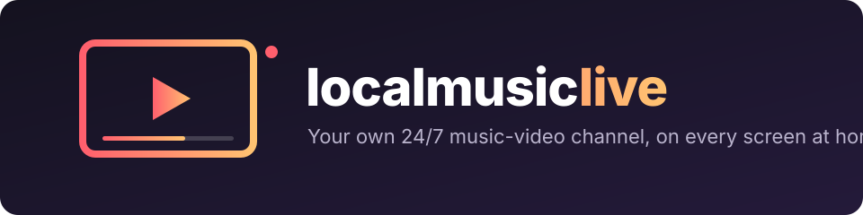
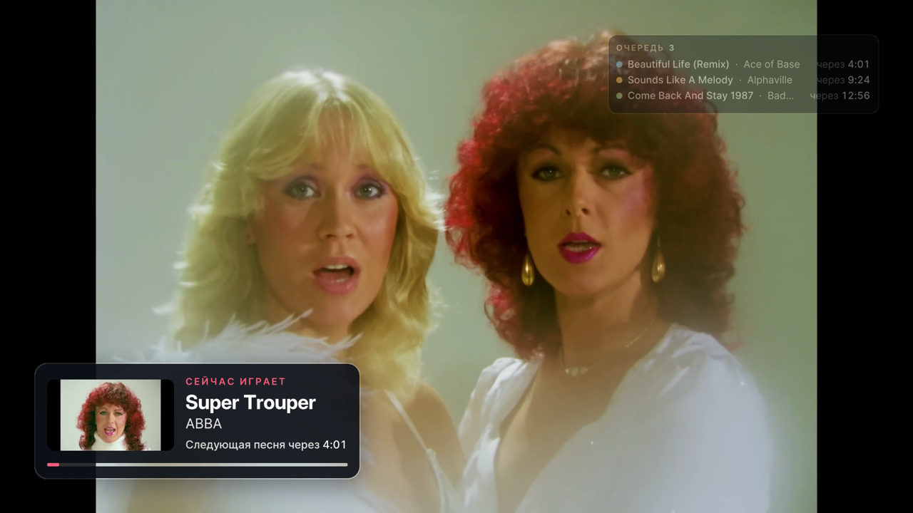
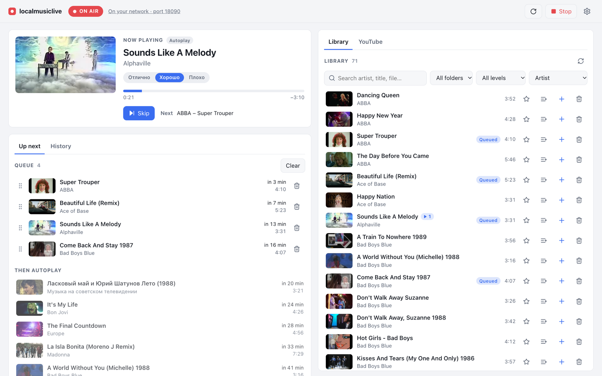
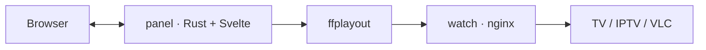

<p align="center">
  
</p>

<p align="center">
  
  
  
  
</p>

<p align="center">
  Turn a folder of music videos into a live TV channel that never stops,<br>
  run it from a web panel, and watch it on any screen at home.
</p>

<p align="center">
  
</p>

## Features

- **Always on air:** autoplay takes over when the queue is empty
- **Live queue:** reorder, play next or skip without cutting off the song on air
- **Song ratings:** autoplay favours your best songs and never plays the bad ones
- **On-screen card:** "Now playing" / "Up next" with a countdown, fully customizable
- **YouTube:** search, download and queue in one click
- **Ad breaks:** optional breaks every few songs, with videos from `media/ads/` (the panel can keep it filled with the newest commercials from [advertunes.ru](https://advertunes.ru), Первый канал and Россия 1 first)
- **Watch anywhere at home:** TV browser, IPTV app or VLC, with no streaming platform in between

<p align="center">
  
</p>

## Quick start

You need [Docker](https://www.docker.com/products/docker-desktop/) and some music videos.

```bash
git clone https://github.com/maksimts-kool/localmusiclive.git
cd localmusiclive
cp .env.example .env          # then set FFPLAYOUT_PASSWORD
cp ~/Videos/*.mp4 media/      # name them "Artist - Title.mp4"
docker compose up -d --build  # the first build takes a few minutes
```

Open **<http://localhost:8080>** and press **Start**.

## Watching

Find your computer's IP address with `ipconfig getifaddr en0`, then open it on any device on your network:

| Device | URL |
| :--- | :--- |
| TV browser | `http://<ip>:8090` |
| IPTV app | `http://<ip>:8090/channel.m3u` |
| VLC | `http://<ip>:8090/live/stream.m3u8` |

Only the stream is reachable from your network; the panel stays on this computer.

## Configuration

All settings are in [`.env.example`](.env.example) and take effect after
`docker compose up -d`. They cover resolution, bitrate, ports, time zone
and YouTube limits. Queue, autoplay and on-screen card options are in the
panel's settings.

## How it works



[ffplayout](https://github.com/ffplayout/ffplayout) plays a daily playlist and
encodes the stream. The panel rewrites the playlist after the current song
every time the queue changes, and draws the on-screen card that ffplayout
overlays on the picture.

## Development

```bash
docker run --rm -v "$PWD/panel/backend":/src -w /src rust:1-bookworm cargo test  # backend tests
cd panel/frontend && npm install && npm run dev                                   # frontend dev server
```

## License

No license yet; all rights reserved. Only stream media you are allowed to play.
